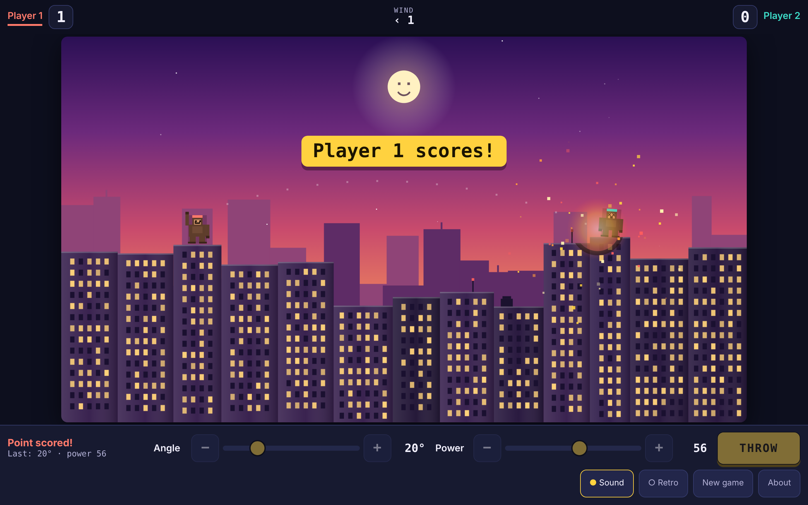
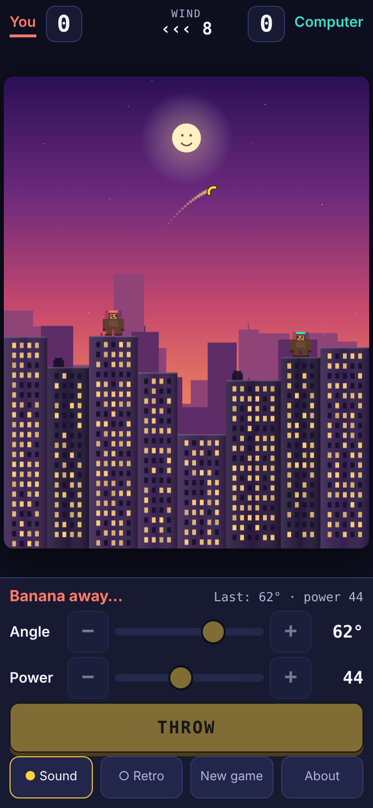
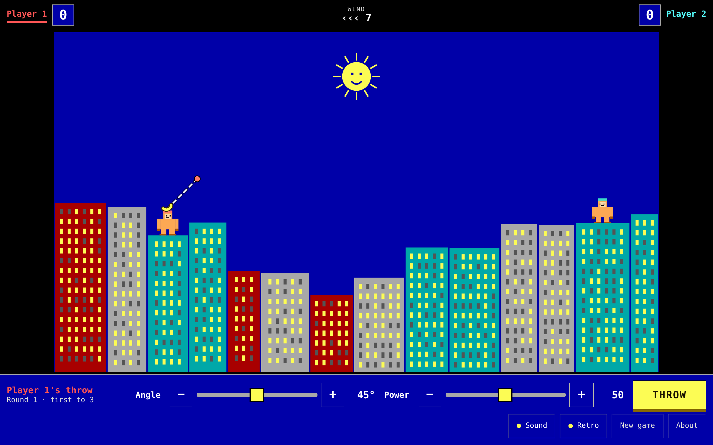

# Banana Skyline

Two gorillas, one skyline, a lot of bananas. Pick an **angle** and a **power**, throw, watch what
the wind and gravity do, adjust, throw again. A small browser tribute to the QBasic gorillas game
of the early 1990s.



| Phone | Retro Mode |
|---|---|
|  |  |

## Run it

Needs Node 20 or newer.

```bash
npm install
npm run dev        # opens a playable game at http://localhost:5173
```

| Command | What it does |
|---|---|
| `npm test` | Simulation tests: trajectory, collisions, turns, scoring, computer opponent |
| `npm run build` | Type-checks and writes the static site to `dist/` |
| `npm run preview` | Serves `dist/` locally |
| `npm run evidence` | Plays full matches in headless Chrome and refreshes `docs/screenshots/` (needs Google Chrome; run `npm run build` first) |

`dist/` is plain static files with relative paths: drop it on any static host (GitHub Pages,
Netlify, S3, a USB stick). No server, accounts, secrets or network calls.

## Play

- **Solo** against the computer (default) or **two players** on one device — *New game* switches.
- First to 3 points wins the match (1 or 5 also available). Every point starts a fresh skyline.
- Hitting yourself gives the other gorilla the point.
- The dotted line left in the sky is your previous throw; the panel shows its angle and power.

| Input | Action |
|---|---|
| Sliders, − / + buttons | Angle and power |
| ← → | Angle (Shift: ×5) |
| ↑ ↓ | Power (Shift: ×5) |
| Space / Enter | Throw |
| M / R | Sound on/off, Retro Mode |

Add `?seed=123` to the address to replay a particular first skyline. The game honours the
system "reduce motion" setting (no shake, particles or spinning); `?motion=reduce` forces it.

## How it is put together

See [context/architecture.md](context/architecture.md). The short version: `src/sim` is pure,
seeded, fixed-timestep game logic with no browser dependencies; `src/render.ts` draws it;
`src/main.ts` wires up input and timing.

## Evidence

- `npm test` — 17 tests, including "same seed and inputs give the identical path and result".
- `npm run evidence` — drives the real UI: keyboard throw on desktop, a full two-player match to 3
  and a rematch that starts 0–0, the computer taking turns and scoring with zero network requests,
  Retro Mode, live resizing, touch controls and 44px targets on a phone viewport, no console errors.
- Screenshots: [docs/screenshots/](docs/screenshots/).

## Known limits

- Sound and animation feel were checked by automated play and screenshots, not on physical phones.
- The computer opponent has one difficulty.
- The "nice after v1" list in the intent (daily challenge, achievements, best scores, replay
  capture) is not built.

## Credits and provenance

Inspired by *GORILLAS.BAS*. All code, art and sound here are original and generated at runtime;
nothing from the original game is included. Not affiliated with or endorsed by Microsoft or IBM.

Built with Intent-Driven Engineering from [intent/INTENT-001-banana-skyline.md](intent/INTENT-001-banana-skyline.md),
starting from [intent-drive-starter](https://github.com/kendallmark3/intent-drive-starter)
(its original README is kept as [STARTER.md](STARTER.md)).
